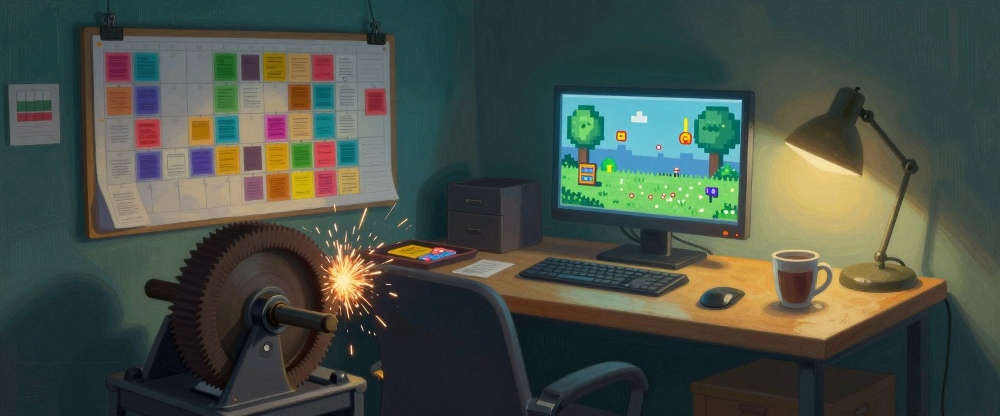

# grindwright



Keeps an indie game moving the way a grinding solo dev would. It ranks work across lanes by value first, with a person's minutes as the discount. It does what needs no person, asks its questions where the project already talks (issues, pull request comments, discussions, the wiki) or, when there is no such place or the owner prefers it, on an askwright decision page, and moves to another lane instead of waiting. Every session ends with the same start command.

Status: 0.1.0. Unit tests pass. No live pilot yet, so it has not yet moved a real game. Expect rough edges.

## Install

As a Claude Code plugin:

    /plugin marketplace add m4bwav/grindwright
    /plugin install grindwright@grindwright

Then say "grind on my game" in the game's folder. Details are in the [wiki](https://github.com/m4bwav/grindwright/wiki).

## What's inside

- `skills/grindwright/SKILL.md`: the loop and its rules.
- `skills/grindwright/scripts/grw.py`: ledger, selector, gates. `grw.py --help` lists the commands.
- `skills/grindwright/scripts/grind_loop.py`: bounded unattended driver. Dry run by default.

It does not promise a finished game. No game found in the survey shipped from truly unattended work, and whether a game is fun stays a person's call.

Plugs into artwright, pixelwright, musicwright, sfxwright, cinewright, game-juice, polywright, ludowright, comfyui-gen and marketwright when present, and says which lanes are closed when one is missing.

## New work off

When the pull requests, issues and questions pile up faster than you can review them, turn new work off. The grind keeps answering what you raised (review comments, answers, green lights, merge conflicts and broken picture links on its open PRs) and starts nothing new: no backlog items, no discovery, no proposals, no new questions. With nothing of yours left it stops cleanly as `no-new-work`. Turn it back on and the backlog ranks exactly as before.

```
python skills/grindwright/scripts/grw.py --state <project>/ai-docs/grind new-work off
python skills/grindwright/scripts/grw.py --state <project>/ai-docs/grind new-work on
python skills/grindwright/scripts/grw.py --state <project>/ai-docs/grind new-work show
```

The setting is stored per project. `grind_loop.py --no-new-work` and `grind_crew.py --no-new-work` (or `"no_new_work": true` in the crew file) do it for one run only. Details: [new-work.md](skills/grindwright/references/new-work.md).

## Handing work over

When two people grind one project, each session keeps to its own items and branch. Work moves between them two ways:

- **Stale takeover.** Once an item's owner has gone quiet (no commit on its branch, no claim renewal, for 12 hours by default; set `"takeover": {"stale_hours": N}` in `profile.json`), `grw.py next` offers it as `continue-stale` and `claim` takes it over, continuing on top of the owner's branch in a new worktree. A live owner is never taken over.
- **Handoff on purpose.** `grw.py handoff <id> --to jennifer --left "..." --next "..."` pushes the work in progress, writes the note, releases the claim and marks the item for the addressee (or `anyone`). Run from a terminal while the owning session is away, it only releases and marks.

Details: [references/handoff.md](skills/grindwright/references/handoff.md).

## Works with

grindwright picks the work. The real making happens in other plugins, and the more of them are installed, the more lanes it can run without you.

- [askwright](https://github.com/m4bwav/askwright): every question grindwright can't answer goes on an askwright page, recorded in the ledger. It switches lanes instead of waiting, and the next session reads your answers. Ten decisions take one sitting, not ten interruptions.
- Lane plugins: [pixelwright](https://github.com/m4bwav/pixelwright) (animation), [artwright](https://github.com/m4bwav/artwright) (art), [sfxwright](https://github.com/m4bwav/sfxwright) and [musicwright](https://github.com/m4bwav/musicwright) (sound and music), [voicewright](https://github.com/m4bwav/voicewright) (voices), [cinewright](https://github.com/m4bwav/cinewright) (shots and edits), [polywright](https://github.com/m4bwav/polywright) (3D models), [ludowright](https://github.com/m4bwav/ludowright) (balance) and [editwright](https://github.com/m4bwav/editwright) (writing). A lane counts as workable only when its plugin is installed, so the selector never ranks work that nothing can do.
- [tokenwright](https://github.com/m4bwav/tokenwright): holds skill and session budgets down, which matters when grindwright runs many sessions in a row.

Details and an example run: [Works with](https://github.com/m4bwav/grindwright/wiki/Works-With).
